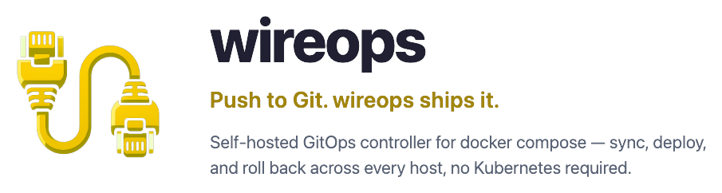
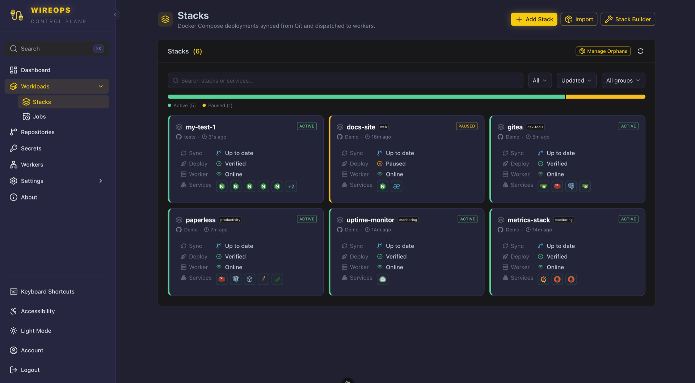
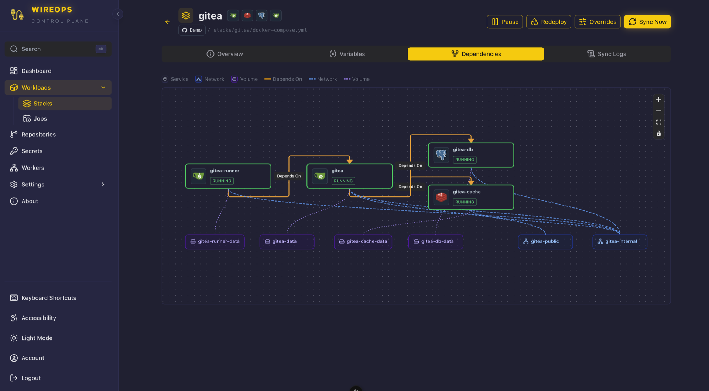
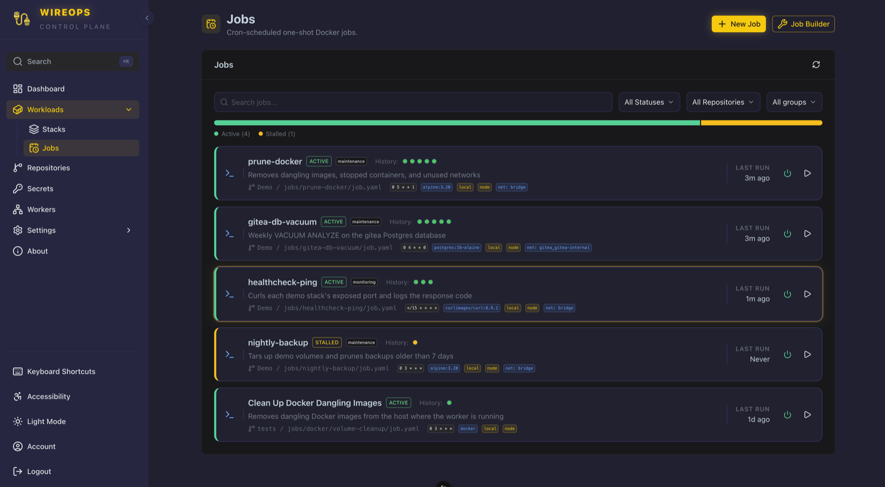
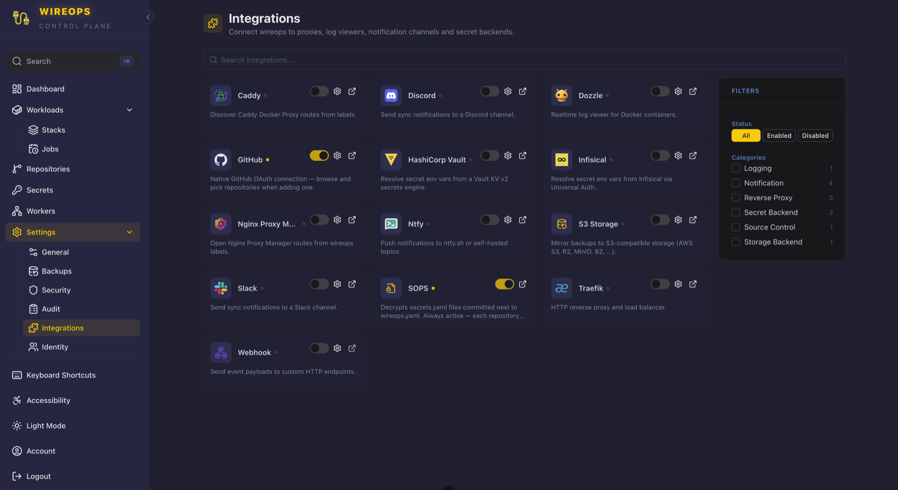
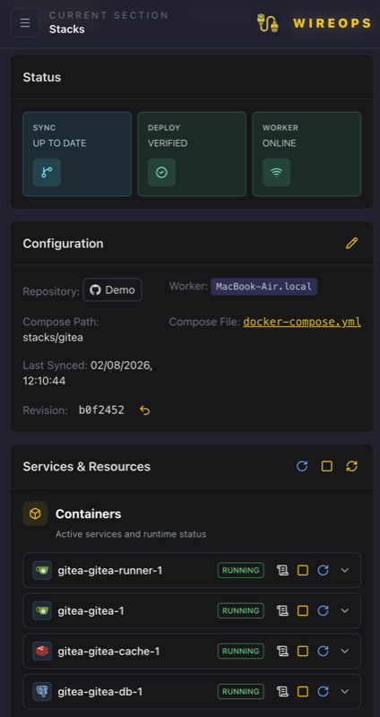

<p align="center">
  
</p>

[](https://github.com/wireops/wireops/releases/latest)
[](https://github.com/wireops/wireops/actions/workflows/server-ci.yml)
[](https://github.com/wireops/wireops/actions/workflows/worker-ci.yml)
[](.govulncheck-allowlist.txt)
[](https://app.codacy.com/gh/wireops/wireops/dashboard)
[](https://app.codacy.com/gh/wireops/wireops/dashboard)
[](LICENSE)

**Push to Git. wireops ships it.** A self-hosted GitOps controller that watches your repos and rolls out `docker compose` changes across every host you own — no Kubernetes, no manifest sprawl, no SSH-and-pray deploys. Think Flux/ArgoCD, but for plain Compose stacks.

📚 **Documentation**: [wireops.dev](https://wireops.dev/docs/) · [Português (Brasil)](https://wireops.dev/pt-BR/docs/) — install, architecture, API reference, operations, security, integrations, troubleshooting. Security reports go to [SECURITY.md](SECURITY.md).

## Features

- 🐳 Docker Compose stack management
- 🔄 Automatic synchronization from Git repositories
- 📄 Single-file stacks — one compose file with an `x-wireops` block, still runnable by `docker compose`
- 🔍 Compose linting before deploy, with findings mapped to the line in your file
- 📊 Real-time container monitoring, logs and stats
- ⏱️ Per-phase deploy timeline — fetch, lint, render, secrets, policy, dispatch, compose up, post-check
- 🕸️ Per-stack dependency graph of services, networks and volumes
- 🔐 Share secrets to your Stack/Job with SOPS+age, HashiCorp Vault, Infisical integrations
- 🗂️ Config files committed to git, mounted into services and tracked by checksum
- 🛡️ Strong Policy and RBAC system, with audit logging
- 🔑 SSO login via any OIDC provider, plus service accounts with scoped API keys
- 🐙 Native GitHub and GitLab OAuth connect, including self-hosted GitLab
- 🌐 Webhook, Discord, Slack, and ntfy notifications
- 📈 Prometheus `/metrics` for the server and every worker
- 🚀 Force redeploy with recreate options
- 🗓️ Cron-scheduled one-shot Docker jobs
- 🔄 Rollback to previous commits, with every deploy kept as a readable revision
- 📦 Private registry credentials, scoped to a stack's deploy
- 💾 Backups with schedule, retention and restore — optionally mirrored to S3, encrypted client-side
- 📥 Import Compose projects already running on a host, or migrate a stack to another repository
- 🤖 Read-only MCP server, so an AI agent can inspect stacks and scaffold new ones
- 💻 Audited web terminal, RBAC-gated
- 🎛️ Optional render-time stack overrides (image/ports/networks/scale) for one-off validation testing, without a git commit

## Screenshots

*Click any screenshot to zoom.*

<p align="center">
  <a href=".github/assets/screenshots/stacks-overview.png"></a><br>
  <sub><b>Stacks</b> — every Compose deployment, sync/deploy status, and assigned worker</sub>
</p>

<p align="center">
  <a href=".github/assets/screenshots/dependency-graph.png"></a>
  &nbsp;
  <a href=".github/assets/screenshots/jobs.png"></a><br>
  <sub><b>Dependency graph</b> — services, networks and volumes per stack · <b>Jobs</b> — cron-scheduled containers with run history</sub>
</p>

<p align="center">
  <a href=".github/assets/screenshots/integrations.png"></a>
  &nbsp;
  <a href=".github/assets/screenshots/mobile-stack-detail.png"></a><br>
  <sub><b>Integrations</b> — Traefik, Caddy, Dozzle, Vault, Infisical, SOPS, S3, and more · <b>Mobile</b> — manage stacks from your phone</sub>
</p>

## How it works

The **server** (Go + PocketBase, with the Nuxt SPA embedded) handles reconciliation, scheduling and state — it never touches Docker. The **workers** connect *out* to it over a token-authenticated WebSocket and are the only thing running `docker compose` on a host. Adding a host means starting a worker with a token; nothing reaches into it. See the [architecture guide](https://wireops.dev/docs/reference/architecture/).

## Requirements

- A Linux host on `amd64` or `arm64`.
- Docker Engine `25.0+` and Docker Compose `v2.24.1+` (`docker compose`).
- Worker access to the Docker socket or configured Docker endpoint.
- Network access from every worker to the server; use TLS or a private network for remote workers.

Keep the server and every worker on the exact same release — see the [compatibility policy](https://wireops.dev/docs/operations/compatibility/) before upgrading either.

## Quick Start

Server first, then one or more workers that register against it. `example/docker-compose.yml` has both.

**1. Start the server.** `SECRET_KEY` encrypts every secret wireops stores — git passwords, SSH keys, integration tokens — so treat it like a production credential:

```bash
cp example/.env.example example/.env
# Set SECRET_KEY (openssl rand -hex 32), BOOTSTRAP_TOKEN, WORKER_TAGS,
# and DOCKER_GID on Linux. Set APP_URL if this isn't localhost.

cd example
docker compose up -d wireops
```

**2. Create the first administrator.** There are no default credentials. Open `http://localhost:8090/setup`, enter your `BOOTSTRAP_TOKEN` and create the account. The route closes itself once an admin exists; keeping or dropping the token afterwards changes nothing, but dropping it is tidier.

**3. Issue a worker token.** **Workers → Add Worker** in the UI, then copy the token.

**4. Start a worker.**

```bash
# still in example/
WORKER_TOKEN=paste-the-token-here WORKER_TAGS=prod,eu-west-1 docker compose up -d wireops-worker
```

It connects out, registers, and flips to `ACTIVE` in **Workers** within a few seconds. `WORKER_TAGS` says what a worker is *for* (`prod`, `eu-west-1`) — required, comma-separated, set on the worker itself. Stacks and jobs can require tags, so only matching workers show up as targets.

> **Linux permissions:** the containers run as UID/GID `1000`. Create `example/data` writable by that identity before the first start, and set `DOCKER_GID` to the Docker socket's numeric group (`stat -c '%g' /var/run/docker.sock`). `example/.env.example` has the commands. Linux is the supported production environment.

The example pins `WIREOPS_VERSION` instead of tracking `latest`. Port `8443` is plain HTTP/WebSocket while `TLS_ENABLED=false` — remote workers should use native TLS or a private network. Read the [production guidance](https://wireops.dev/docs/operations/production/) before exposing an instance.

## Defining a stack

A stack is a compose file in a Git repository plus a top-level `x-wireops` block telling wireops how to deploy it. `x-*` is a [compose extension field](https://docs.docker.com/reference/compose-file/extension/), so `docker compose up` still runs the file unchanged:

```yaml
x-wireops:
  version: wireops.v1
  name: api
  group: platform         # optional, groups stacks in the UI
  timeout: 5m             # deploy timeout
  sync:
    interval: 2m          # how often this stack's repo is polled
  worker:
    tags: [prod, amd64]   # which workers may run it
  compose:
    remove_orphans: true
  jobs:
    wait_running: true    # wait for related jobs before deploying

services:
  api:
    image: ghcr.io/acme/api:1.4.2
    restart: unless-stopped
```

Point a stack at the file in **Stacks → New** and wireops re-reads the block from git on every sync — those fields aren't editable through the API, so git stays the source of truth. The older two-file layout (a separate `wireops.yaml`) still works, but `x-wireops` is the path for anything new.

Environment variables live in wireops — per stack, per job, or shared globally — and can be marked secret.

### Scheduled Jobs

A `job.yaml` in a repo defines a one-shot container on a cron schedule. The file is the single source of truth, and the `resources` block is mandatory:

```yaml
name: "Database Backup"
description: "Nightly backup of the postgres database"
cron: "0 2 * * *"
image: "postgres:15-alpine"
command: ["pg_dump", "-h", "db", "-U", "postgres", "mydb"]
tags: ["backup", "prod"]
mode: "once"          # once | once_all
volumes:
  - "/opt/backups:/backups"
network: "prod_network"
resources:
  cpu: "0.5"          # required
  memory: "512m"      # required
  timeout: "15m"      # required
```

## Integrations

Plugins register themselves in `internal/integrations/` and are configured from one Settings screen: **container actions** (Traefik, Caddy, Nginx Proxy Manager, Dozzle) add Open/Logs shortcuts to the container list; **notifications** (Webhook, Discord, Slack, ntfy) fire on sync events; **secret backends** (Vault, Infisical, SOPS), **storage** (S3, for backup mirroring) and **source control** (GitHub, GitLab) back the features above.

Plugin interface, config fields and label examples: [Integrations](https://wireops.dev/docs/integrations/).

## Environment Variables

`SECRET_KEY` is required. `BOOTSTRAP_TOKEN` is required only until the first administrator is created. Everything else has a default.

Full server/worker reference, SMTP, OIDC/SSO, Vault/Infisical, SOPS+age: [Environment Variables](https://wireops.dev/docs/reference/environment-variables/) · [Observability](https://wireops.dev/docs/reference/observability/) · [MCP Server](https://wireops.dev/docs/reference/mcp-server/) · [Disaster Recovery](https://wireops.dev/docs/operations/disaster-recovery/).

## Production

The quick start is there to prove the install. Before running anything you care about: pin the image version, enable TLS for remote workers, configure off-host backups, keep `SECRET_KEY` somewhere separate, and test one restore. Then follow the [production checklist](https://wireops.dev/docs/operations/production/), [compatibility policy](https://wireops.dev/docs/operations/compatibility/) and [upgrade guide](https://wireops.dev/docs/operations/upgrading/).

## Development

```bash
make dev                  # backend :8090 (admin at /_/) + frontend :3000
START_WORKER=true WORKER_TOKEN=... make dev    # ...and a local worker

go test ./...             # backend
cd frontend && npm run test && npm run lint

make all                  # production build: SPA into pb_public/, then the binary
```

`AGENTS.md` is the deep reference — data model, every custom endpoint, business flows, conventions.

## Project Scope

For developers, homelabs and self-hosters running plain `docker compose` across one or many hosts and repos: GitOps sync and deploy, without manifest sprawl or control-plane complexity.

**Not** a Kubernetes/Swarm alternative, and not a competitor to Flux/ArgoCD. For multi-node autoscaling, HA or compliance-grade orchestration, prefer Kubernetes. No OCI-artifact source, Swarm/multi-node, or canary/preview deploys yet — strategic backlog, no ETA.

## License

AGPLv3 — see [LICENSE](LICENSE). wireops is free/open-source software. Forks and derivative works must also be released under AGPLv3 (or a compatible license) and must credit **wireops** ([github.com/wireops/wireops](https://github.com/wireops/wireops)) as the original project — see [NOTICE](NOTICE).

## Contributing

Contributions are welcome — open an issue or PR. Security reports must follow [SECURITY.md](SECURITY.md) instead of a public issue. User-visible changes go in the `Unreleased` section of [CHANGELOG.md](CHANGELOG.md).
